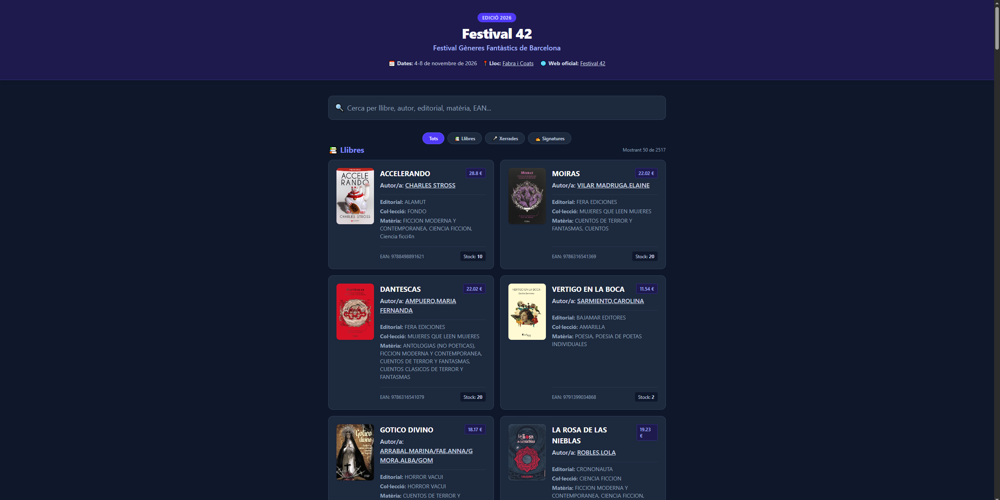
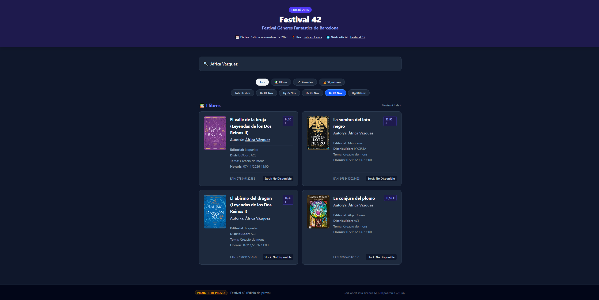

# 🧪 Test Festival 42 - Static Web Prototype

This repository is a **testing prototype** for a lightweight, serverless catalog and schedule service designed for **Festival 42** (Festival Gèneres Fantàstics de Barcelona).

It is built as a single-page static web app using **HTML5, Tailwind CSS v4 (compiled locally via CLI), and Vanilla JavaScript**, prioritizing performance, instant search, security (like strict Content-Security-Policy compliance) and zero maintenance overhead.

---

## 📸 Screenshots

Here is a quick look at the user interface and responsive experience across different devices:

### 🖥️ Desktop Experience

| Homepage View | Search & Filter View |
| :---: | :---: |
|  |  |

### 📱 Mobile Experience

| Homepage View | Search & Filter View |
| :---: | :---: |
| Coming soon | coming soon |

---

## 📂 Project Structure

```text
test-festival42/
├── index.html               # Public frontend interface (search, filters, rendering)
├── styles.css               # Compiled, purged, and minified production Tailwind CSS
├── src/
│   └── input.css            # Tailwind CSS v4 source stylesheet (@import "tailwindcss";)
├── package.json             # Node.js project and dependencies configuration
├── package-lock.json        # Node.js Locked dependency versions for exact deterministic installs
├── data.json                # Public processed dataset consumed by the web app
├── node_modules/            # Node.js local dependencies (ignored by Git)
├── data/                    # CSV dataset files and PDF files for book covers
│   ├── catalog.csv
│   └── catalog.pdf          # Official PDF catalog (ignored by Git)
├── assets/                  # Public static assets
│   └── covers/              # Extracted optimized WebP book cover images (named by EAN)
├── screenshots/             # Documentation screenshots for the README
├── scripts/                 # Python development and automation tools
│   ├── generate_catalog.py  # Script for massive synthetic load testing data
│   ├── process_catalog.py   # Script to process raw catalog CSV and convert it into a JSON payload for the web app
│   └── extract_covers.py    # Script to extract book covers from Azeta (distributor) PDF catalogs
├── requirements.txt         # Python package dependencies
├── .venv/                   # Python virtual environment (ignored by Git)
├── .gitignore               # Git exclusion rules
└── README.md                # Project documentation

```

---

## 🎨 Tailwind CSS Local Compilation

To maintain a strict Content-Security-Policy (CSP) without `unsafe-eval` or external script CDNs, Tailwind CSS is compiled locally using the modern **Tailwind CLI v4**.

### Setup & Compilation Steps

Ensure you have [Node.js](https://nodejs.org/) installed (recommended via [NVM](https://github.com/nvm-sh/nvm)):

1. Install project dependencies:
```bash
npm install -D tailwindcss @tailwindcss/cli

```

2. Compile the production stylesheet (`styles.css`) from your source input:
```bash
npx @tailwindcss/cli -i ./src/input.css -o ./styles.css --minify

```

3. *(Optional)* Run in watch mode during active frontend development:
```bash
npx @tailwindcss/cli -i ./src/input.css -o ./styles.css --watch

```

---

## 🐍 Python Environment & Dependencies

Python scripts that interact with PDF documents require an isolated virtual environment and package dependencies:

```bash
python3 -m venv .venv
source .venv/bin/activate
pip install -r requirements.txt

```

---

## 🚀 How to Run Locally

Because modern browsers enforce CORS security policies on local files (`file://`), you need a lightweight local server to test it:

1. Open your terminal in the project root directory.
2. Run a local Python server:

```bash
python3 -m http.server 8000

```

3. Open your web browser and go to: `http://localhost:8000`

---

## 📋 Raw CSV Schema

The source CSV must follow the updated semicolon-delimited structure:

```text
EAN;LLIBRE;AUTORI;EDITORIAL;DISTRIBUÏDOR;TIPUS;PVP;TEMA;HORARIS

```

* **Price (`PVP`)**: Automatically defaults to `0.0` if empty or blank.
* **Quantity**: Defaults to `0` since it is absent in the raw source.
* **Text Values**: Cleaned, Unicode-normalized, and stripped of trailing whitespace while preserving original raw text.

---

## 🔄 How to Update the Catalog & Test Performance

1. Place your raw semicolon-delimited CSV source file (exported from booksellers, typically in legacy `cp1252` encoding) inside your workspace.
2. **Process and convert the catalog:** Clean text, fix encoding, normalize Unicode, map headers, default missing quantities and prices to 0, verify local cover files, and generate the public `data.json` payload:

```bash
python3 scripts/process_catalog.py data/catalog_raw.csv data.json --encoding cp1252

```

*(Optional: You can pass `--replacements replacements.json` to handle specific recurring source typos, or `--no-minify` for an indented readable JSON).*

*(You can also check available options using `python3 scripts/process_catalog.py --help`)*.

*(Alternatively, to generate massive synthetic datasets for performance and scalability testing instead of real data, run:)*

```bash
python3 scripts/generate_catalog.py --books 500 --talks 20 --signings 30 -o data/massive_catalog.csv
python3 scripts/process_catalog.py data/massive_catalog.csv data.json

```

*(You can also check available options using `python3 scripts/generate_catalog.py --help`)*.

3. **Extract and optimize book cover images from the official PDF catalog:** Ensure your virtual environment is active, then run the extractor script to automatically crop, extract EANs, and convert covers to high-performance WebP format (PDF files are ignored by Git):

```bash
source .venv/bin/activate
python3 scripts/extract_covers.py data/catalog.pdf

```

*(You can also check available options using `python3 scripts/extract_covers.py --help`)*.

4. Compile your CSS changes if necessary, then commit and push `index.html`, `styles.css`, `src/input.css`, `data.json`, and cover assets (`assets/covers/`) to deploy changes via GitHub Pages.

---

## 🛡️ Security Audit

This static prototype is audited locally using **OWASP ZAP** via Docker.

### Prerequisites

* Docker
* Local server running (`python3 -m http.server 8000`)

### Run local scan (baseline)

```bash
docker run --rm -v $(pwd):/zap/wrk/:rw -t --add-host=host.docker.internal:host-gateway ghcr.io/zaproxy/zaproxy:stable zap-baseline.py -t http://host.docker.internal:8000 -J zap_report.json -r zap_report.html

```

### Run local scan (full)

```bash
docker run --rm -v $(pwd):/zap/wrk/:rw -t --add-host=host.docker.internal:host-gateway ghcr.io/zaproxy/zaproxy:stable zap-full-scan.py -t http://host.docker.internal:8000 -j -J zap_report.json -r zap_report.html

```

---

## 📄 License

Open-source project distributed under the [MIT License](https://opensource.org/licenses/MIT). Feel free to fork or adapt for other cultural events or book fairs.
